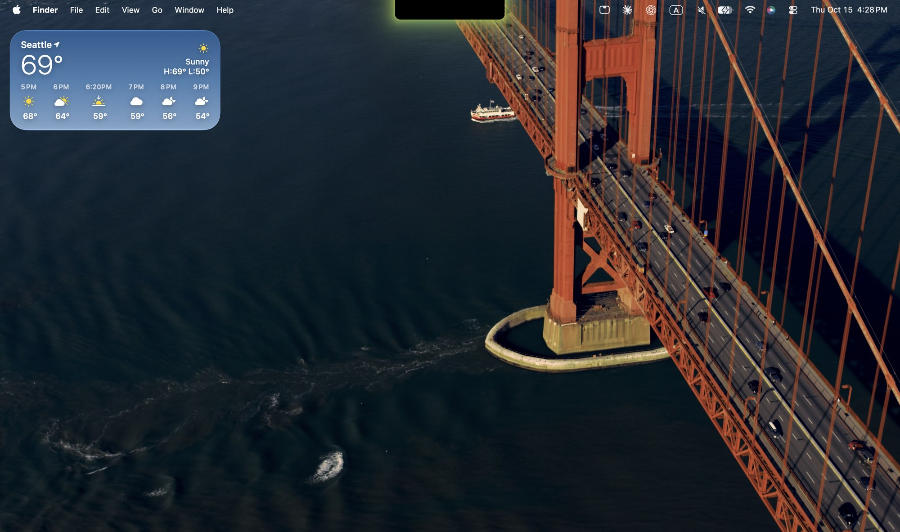
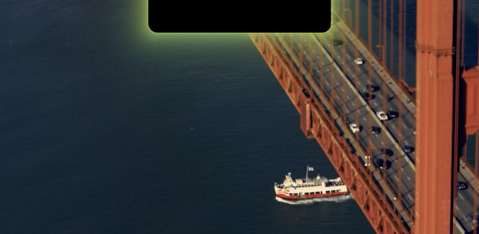
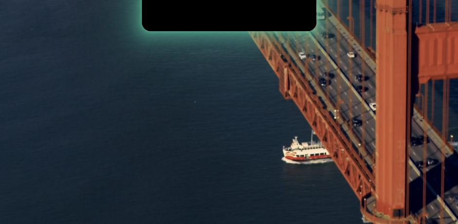
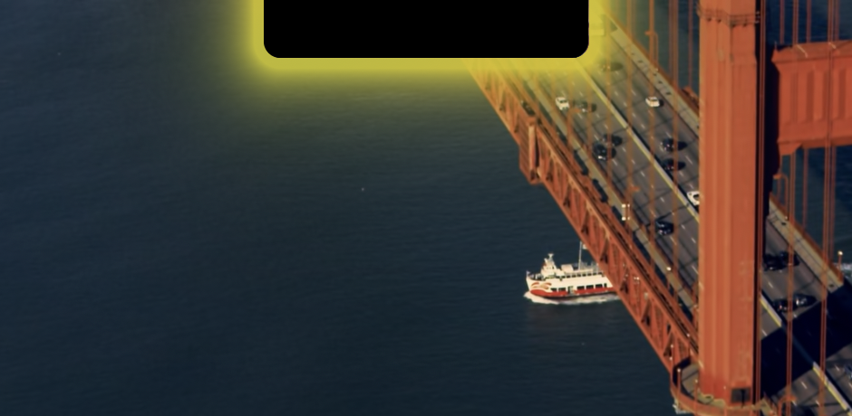
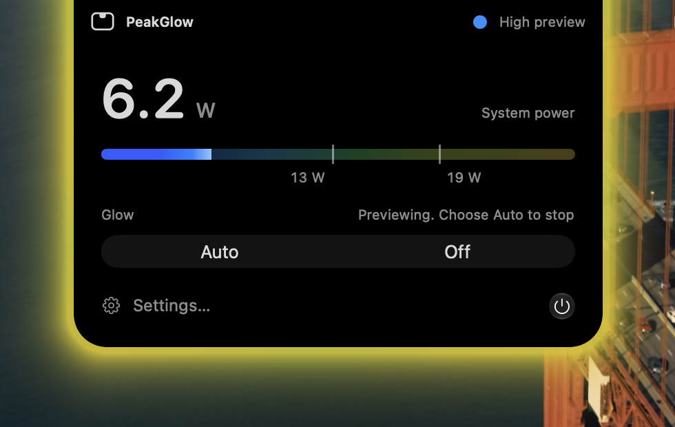

# PeakGlow

**Maintained by aweekdayz. Native macOS. Quiet by design.**

A small macOS utility that shows system load as a soft glow around the MacBook notch, with native Liquid Glass controls and English Settings. Product direction, interface refinement and maintenance are led by aweekdayz, with AI-assisted development.

[Credits and provenance](CREDITS.md) acknowledge the original project and contributors.

## Screenshots



The glow follows system power: blue at low power, then cyan, green and yellow as it rises. The picture above shows **Auto** under a full CPU load on a MacBook Air (M2), where the glow has risen to yellow-green. The three below are the same glow at its levels. Auto is live, taken under the load just described; Mid and High were taken with the glow previews in Settings → Glow, so they show what each level looks like rather than a live workload.

| Auto, under load | Mid | High |
| --- | --- | --- |
|  |  |  |

Hovering over the notch opens the controls as an island that grows out of it, with the glow following its outline. The live power reading and a meter in the glow's own colors are at the top.



macOS screenshots do not include the hardware notch, so the black notch in the glow images and the desktop picture is drawn in at its real size. The glow and the island are as the app draws them. The island image was taken while previewing High, which is why the reading is low while the glow is yellow.

## Download

[Latest published release](https://github.com/aweekdayz/notchpeakglow/releases/latest).

Quit any running copy, open the **DMG** and drag PeakGlow to Applications. (A ZIP is also provided.) Existing preferences are retained. From 1.7.1 the app is signed with a Developer ID certificate and **notarized by Apple**, so it opens normally. From 1.8.0 it **updates itself**: it checks about once a day, and Settings → About has a switch and a Check for Updates… button. Earlier versions have no updater, so install 1.8.0 by hand once.

The latest published release is **1.8.0 / Build 52**. See [Release audit](docs/Release-Audit.md) for what was checked and what was not.

## Requirements and compatibility

- macOS 26 or later. Developed and checked on macOS 27.2; macOS 26 is supported by the build (minimum system version 26.0) but has not been run on a Mac with macOS 26 yet.
- Apple Silicon MacBook with an available built-in notch display.
- Xcode with the macOS 27 SDK and Metal Toolchain for source builds (the app deploys back to macOS 26).

| Device or configuration | Behavior | Validation status |
| --- | --- | --- |
| Notched MacBook Air, 13 or 15 inches | Air power presets; standard dynamic range when EDR headroom is unavailable | Power and temperature sensors read on a MacBook Air (M2, 2022) with macOS 27.2; other chips not tested |
| Notched MacBook Pro, 14 or 16 inches | Pro power presets; display-dependent extended dynamic range | Family-level implementation; not every chip tested |
| External display connected, lid open | Glow stays on the built-in notch display, even when an external display is primary | Geometry handled in code; hardware verification pending |
| Closed-display mode or no notch display | No glow or hover target; open the app from Finder to access Settings | Safe fallback implemented; hardware verification pending |
| Intel Mac or desktop Mac | Outside the supported distribution target | Not supported |

Device detection uses product metadata and physical display size, rather than assuming a scaled resolution identifies a 16-inch display. Geometry follows the display's actual auxiliary top areas and backing scale. There is no claim of calibration for every M-series chip, core count or workload.

Initial full-glow / Boost presets are **13 / 19 W for Air** and **30 / 55 W for Pro or an unknown family**. These are adjustable starting points. Existing custom thresholds are not silently replaced. Use Settings → Glow to apply the recommended values for your Mac or tune them to your workload.

## Use

PeakGlow has no Dock icon. Its menu bar icon shows system power, switches the Glow mode and opens Settings or Quit without the pointer; turn it off in Settings → General. The Dock icon and menu bar also appear while Settings is open. Hover over the notch for approximately 80 ms to open the controls, which grow out of the notch as an island. Move away, click outside or press Esc to close them; the island covers the notch while it is open, so clicking its top area does not close it. Menus and active mouse drags temporarily defer pointer dismissal.

| Glow mode | Effect |
| --- | --- |
| Auto | Follow measured system power: the color moves from blue through cyan and green to yellow, and the glow grows brighter and wider as power rises; optional subtle glow at low load |
| Off | Turn the glow off |
| Mid | Preview the glow at medium power (green) |
| High | Preview the glow at high power (yellow-green, with gentle breathing) |
| Hot | Preview the temperature warning (steady orange tint) |

The controls panel and the menu bar menu offer Auto and Off. Mid, High and Hot are previews for tuning colors and brightness, so they are in Settings → Glow, next to those settings; while one is on, the panel says so and Auto ends it.

**Battery and charging.** The controls panel shows the charge next to the system power, with the estimated time until full or empty, the power adapter's rating and the power going into or out of the battery, and the menu bar menu has a battery line. Settings → Battery shows the charge, the battery's maximum capacity, its capacity in mAh, the cycle count, the power adapter, the charging or battery power, the current and the voltage, read from the system's battery data. While the Mac charges, a soft green light travels slowly along the notch; plugging in the charger (and reaching full charge) opens an island out of the notch, like the one iOS shows, with "Charging" on the left and the charge and a battery on the right, which closes after a few seconds (a ripple is used if the controls are already open). Turn the light and the island off in Settings → Battery → Charging. The charging light keeps the glow animating, so it uses a little more energy while charging. Some Macs and macOS versions report no battery temperature, and then it is not shown.

The glow adapts to the wallpaper: in Settings → Glow → Look, Wallpaper is Automatic by default (it follows the system appearance), and Light uses deeper colors that stay visible on a bright wallpaper.

The controls expose one Settings button and a direct Quit button. In Auto, a connected game controller pauses the glow. Previews are available in Settings → Glow. Reopening the application from Finder opens Settings.

Settings uses native SwiftUI forms, sliders, toggles and sidebar navigation. The Glow selector is a native AppKit segmented control hosted in SwiftUI, using the system tabs role. Buttons use system Liquid Glass. The controls are a black island that grows out of the notch with a spring animation, with the glow wrapping it as it moves, and contracts back into the notch when you move away; with Reduce Motion on, it fades instead. macOS decides how native materials appear under accessibility and appearance settings.

## How it works

`PowerSampler` reads the AppleSMC `PSTR` float sensor. A five-sample average, hysteresis and continuous dwell determine Low, Mid or High; separately, the average power is mapped around your two thresholds to a smoothed position on the glow's color ramp. Unsupported or failed readings display “Power data unavailable” and clear stale automatic load state. Failed driver connections retry at a bounded interval.

Metal draws outside the actual notch silhouette. A main-run-loop display link drives the animation; a transparent final frame is submitted before idle rendering stops. Display sleep or loss of the notch display stops the hidden renderer. EDR gain is limited by the display's current headroom; there is no requirement for HDR to use the app.

Temperature alerts combine a sustained high-temperature heuristic on recognized MacBook families with the system critical thermal state. Sensor keys vary by hardware. Missing samples clear the heuristic window and alert. A warm glow is a temperature indicator, **not confirmation of CPU throttling or a hardware safety system**.

## Build from source

You do not need to operate the Xcode application to use or build PeakGlow. The build still uses Xcode's compiler, SDK, asset compiler and Metal Toolchain. The checked-in project is sufficient; XcodeGen is optional when regenerating it from `project.yml`.

```sh
git clone https://github.com/aweekdayz/notchpeakglow.git
cd notchpeakglow
bash scripts/build-release.sh
```

If the Metal Toolchain is missing, install it using Xcode's Components settings or:

```sh
xcodebuild -downloadComponent MetalToolchain
```

The build script intentionally fails when required tools are absent. If a restricted runner cannot discover an already installed Metal component, `PEAKGLOW_METAL_TOOLCHAIN=/absolute/path/to/Metal.xctoolchain` selects its real compiler and linker. In that mode, the current shader is compiled separately while Xcode builds Swift and the layered icon. It does not silently substitute an old shader or icon. It compiles the layered `AppIcon.icon`, checks bundle metadata and required resources, signs the staged app and creates a ZIP and checksum in `build/release/`.

By default signing is ad-hoc. For a Developer ID build, set `PEAKGLOW_SIGN_IDENTITY` to an installed Developer ID Application identity. Apple notarization is done by `scripts/notarize.sh`, which wraps this script (see [Notarization](docs/Notarization.md)). A Mac App Store submission needs its own signing, sandbox and API compatibility review.

`scripts/compile-preview-swift.sh` remains a **Swift executable-only fallback**. It validates SDK metadata but does not compile Metal, compile the layered icon, produce a complete application or perform notarization. The original 1.6.0 distribution used that fallback with previously compiled resources.

## Troubleshooting

If the controls show “Power data unavailable” or the glow does not follow system power, open Settings → About and click **Copy Diagnostics**, then paste the result into a [bug report](https://github.com/aweekdayz/notchpeakglow/issues/new?template=bug_report.md). The text lists the Mac model, chip, macOS version, notch display, power and temperature sensor status and your settings. It contains no serial number, user name or other personal data.

## Help test other Macs

PeakGlow has only been verified on one MacBook Air (M2, 2022). If you have another notched MacBook, especially a MacBook Pro, an M3 or newer chip, or an external display, a short report is very useful even when everything works:

1. Open Settings → About and click **Copy Diagnostics**.
2. Open a [report](https://github.com/aweekdayz/notchpeakglow/issues/new?template=bug_report.md) and paste the text. Say whether the glow, the island panel and the power reading looked right.

Also welcome: a report from a Mac running **macOS 26**, which no one has tried yet. The [latest release](https://github.com/aweekdayz/notchpeakglow/releases/latest) supports it (on macOS 26 the Glow selector is a plain segmented control, because the tabs role is new in macOS 27); whether the island animation is smooth on a 120 Hz (ProMotion) display, and how the glow behaves with an external display connected.

## Limitations

- AppleSMC sensor keys and the driver protocol are not a documented public power-measurement API. Availability is not guaranteed on every model or future macOS version.
- The SMC reading is not the same as a wall-outlet power meter and can be affected by charging and hardware behavior.
- Capture exclusion is requested using AppKit; invisibility in all screenshots or recording tools is not guaranteed.
- Reduced Motion is respected. Native system menus and security dialogs follow the system language; PeakGlow's own interface, logs and documentation are English.
- No automated interactive UI tests or cross-model hardware benchmarks have been performed.

## License

PeakGlow is released under the [MIT License](LICENSE). It is based on the original notchpeakglow project, whose README also declares MIT.

## Credits

See [CREDITS.md](CREDITS.md) for the original project, contributors, maintenance scope and licensing (the upstream README declares MIT). The native About PeakGlow window includes the same attribution.

## Application identity

The maintained application uses `com.aweekdayz.peakglow`. On first launch it imports recognized preferences from the previous application's domain, without overwriting settings already saved under the new identity. The compatibility identifier remains only in migration code. Recheck Launch at login after replacing an older application, because its system registration may need to be enabled again.

See [Development notes](docs/Development.md), [HIG review](docs/HIG-Review.md) and [HIG reading log](docs/HIG-Reading-Log.md).
